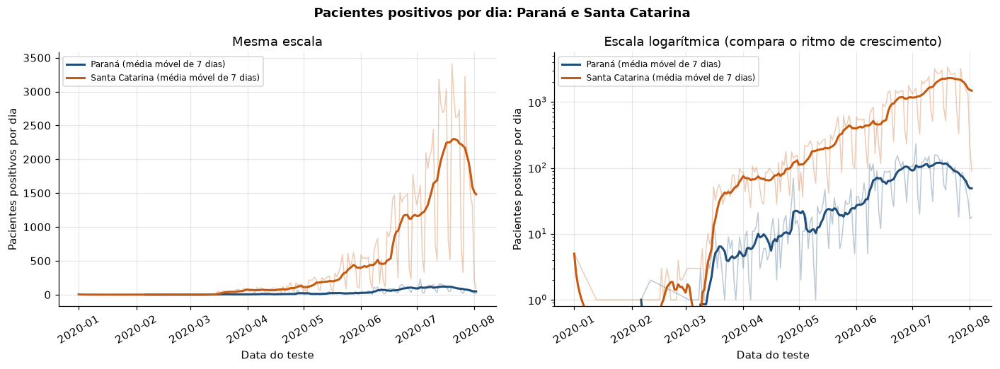
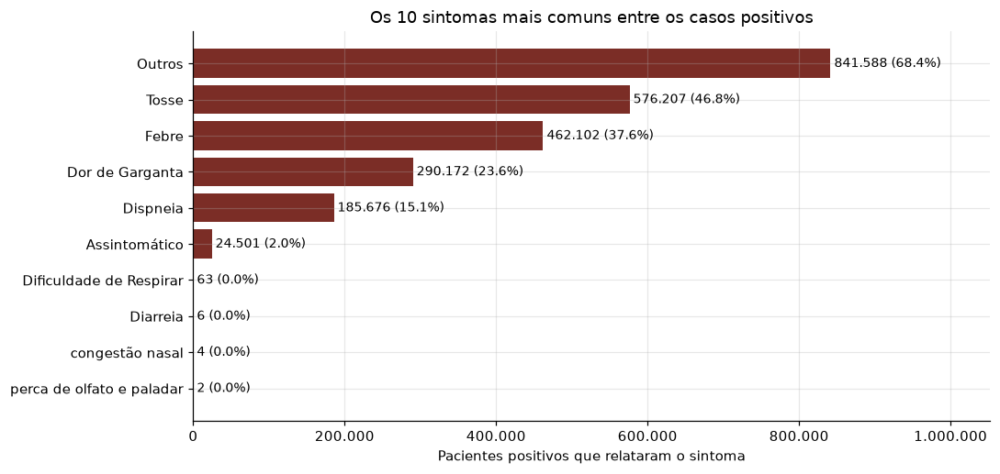
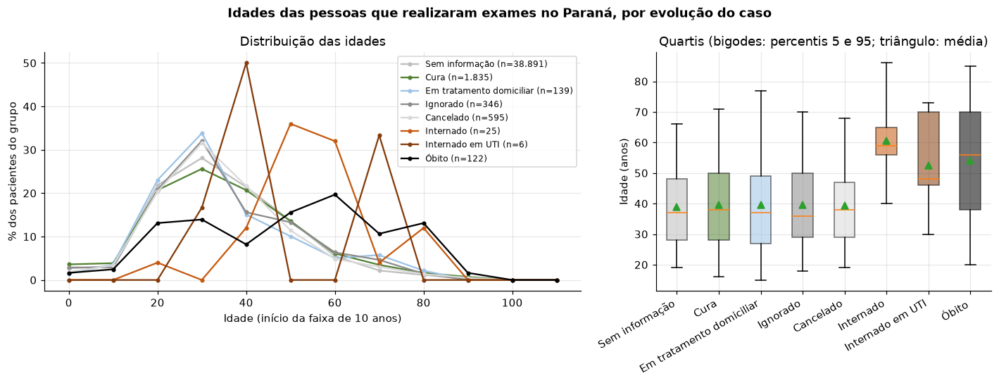

# Big Data com PySpark: COVID-19 no Brasil e histórico da BOVESPA

Três notebooks que respondem perguntas analíticas sobre bases de **milhões de registros** com Apache Spark, usando as três camadas da API: **RDD**, **Spark SQL / DataFrame** e **Spark SQL com visualização**.

Atividades da disciplina **Big Data Analytics** da Especialização em Inteligência Artificial e Ciência de Dados da PUCPR (Prof. Eduardo Viegas).



## Notebooks

| Notebook | Base | API | Perguntas |
|---|---|---|---|
| [`01_spark_rdd_covid.ipynb`](notebooks/01_spark_rdd_covid.ipynb) | exames de COVID-19 no Brasil (amostra de 1 milhão de pacientes) | RDD: `map`, `filter`, `flatMap`, `reduceByKey`, `join`, `subtract` | 21 |
| [`02_spark_sql_bovespa.ipynb`](notebooks/02_spark_sql_bovespa.ipynb) | negociações da BOVESPA de 1986 a 2019 (8,1 milhões de registros) | DataFrame e SQL, cada item resolvido das duas formas | 16 |
| [`03_spark_sql_visualizacao_covid.ipynb`](notebooks/03_spark_sql_visualizacao_covid.ipynb) | exames de COVID-19 no Brasil (4,4 milhões de pacientes) | Spark SQL + Matplotlib | 11 gráficos |

## Abordagem

* **Definições explícitas antes das consultas.** Cada notebook declara o que conta como "positivo", "óbito", "operação" ou "papel", porque a resposta muda conforme a definição.
* **Limpeza dentro do Spark**: valores ausentes (`''`, `null`, `undefined`), municípios gravados com e sem acento, sintomas com grafias diferentes (`Dispneia`, `Dispnéia`, `Dispineia`) e idades impossíveis (179 anos) são tratados antes da agregação.
* **O Spark sumariza, o driver só desenha.** Nenhum gráfico é feito a partir dos milhões de linhas: cada consulta termina em `groupBy(...).agg(...)` e só o resumo vem para o Matplotlib.
* **Mesmo resultado por dois caminhos.** No notebook da BOVESPA cada item tem a versão em API de DataFrame e a consulta SQL equivalente sobre uma visão temporária; ambas passam pelo otimizador Catalyst.
* **Leitura crítica dos dados.** As respostas apontam quando o número reflete a cobertura da base e não o fenômeno (por exemplo, Santa Catarina tem 15 vezes mais positivos que o Paraná porque o Paraná está sub-representado) e quando a unidade da base engana (preços da BOVESPA em lotes de mil ações e em moedas como cruzeiro e cruzado).

## Alguns resultados

**COVID-19 (RDD, 1 milhão de pacientes)**
* 277.848 positivos (27,8%); entre eles, tosse (46,8%) e febre (37,5%) são os sintomas mais relatados.
* Segunda-feira é o dia com mais testes e mais positivos; o volume despenca no fim de semana.
* A taxa de óbito cresce com a idade: abaixo de 0,1% de 10 a 49 anos e acima de 1,5% a partir dos 70.

**BOVESPA (Spark SQL)**
* A PETR4 teve operações em 5.391 pregões, de 1998 a 2019.
* 183.127 papéis distintos; o real responde por 86% dos registros, seguido de cruzeiro, cruzado e cruzado novo.
* Médias e desvios anuais da PETR4 e das 10 ações mais negociadas, com tabela dinâmica (pivot).

**COVID-19 (visualização, 4,4 milhões de pacientes)**

<p>


</p>

O pico de exames foi em 13/07/2020, com 99.016 pacientes em um único dia; a idade é a variável que mais separa desfechos leves de internações e óbitos.

## Como executar

Cada notebook é **autossuficiente** e não depende de nenhum outro arquivo deste repositório. Foi pensado para rodar **localmente** (Windows, Linux ou macOS), mas também roda no Google Colab.

```bash
pip install -r requirements.txt
jupyter notebook notebooks/
```

* **Python 3.9 a 3.12** (recomendado: **3.11**). O PySpark 3.5 não funciona no Python 3.14; a primeira célula avisa se o kernel for incompatível.
* **Java 8, 11, 17 ou 21.** Se não houver um desses na máquina, a primeira célula baixa um JDK 17 portátil para `~/.jdk`, sem alterar o sistema.
* A primeira célula também instala o `pyspark==3.5.9` e o `gdown` se faltarem, e aponta o Spark para o mesmo Python do Jupyter.
* A terceira célula baixa a base para a pasta do notebook na primeira execução; nas seguintes, reaproveita o arquivo.

**Detalhes de execução local resolvidos nos notebooks**

* **Caminho com espaços e acentos.** O caminho do CSV é montado como `file:///E:/pasta com espaços/arquivo.csv`, sem codificar (`%20`, `%C3%A7`), porque o Hadoop não decodifica essas sequências.
* **Timeout dos workers Python no Windows.** No Windows o PySpark não usa o processo *daemon* e cada worker mantém o tempo limite de 15 s da conexão com a JVM; em consultas com *shuffle* (como o `leftOuterJoin`) o worker cai com `TimeoutError`. A sessão define `spark.python.authenticate.socketTimeout = 1h` para evitar isso.
* **Datas reprodutíveis.** O fuso da sessão é fixado em UTC, para que as conversões de data deem o mesmo resultado em qualquer máquina.

## Dados

As bases foram disponibilizadas pelo professor. Como o link original atinge com frequência o limite de downloads do Google Drive, os notebooks baixam cópias idênticas hospedadas no Drive do autor:

| Arquivo | Conteúdo | Tamanho aproximado |
|---|---|---|
| `covid_sample.csv` | amostra de 1 milhão de pacientes testados para COVID-19 até 2020 | 370 MB |
| `covid.csv` | base completa, 4,4 milhões de pacientes | 1,6 GB |
| `bovespa.csv` | negociações diárias da BOVESPA, 8,1 milhões de registros | 1,3 GB |

Por causa do tamanho (o GitHub limita arquivos a 100 MB), as bases não estão versionadas aqui. As saídas de todas as células ficaram salvas nos notebooks, então os resultados podem ser lidos sem executar nada.

## Tecnologias

Python, Apache Spark 3.5 (PySpark: RDD, DataFrame, Spark SQL), Matplotlib, pandas, Jupyter.

## Autor

**César Willian Pacheco**
